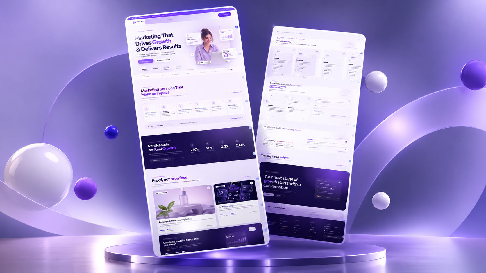

# Marketing-Agency-Website

## ⚡ Built With

  
  

## Overview

Marketing Agency Website is a visually engaging business website concept for a digital marketing agency. It uses a bold purple visual identity, clean layouts, clear typography, and focused calls to action to introduce the agency and guide visitors through its services and content.

The page design brings key agency information together in one place, including marketing service offerings, performance highlights, featured work or content, pricing-style service information, and ways to start a conversation with the agency.

## Highlights

- **Agency-focused hero section:** Introduces the agency's value proposition with prominent messaging and clear calls to action.
- **Marketing services:** Presents the agency's service offerings in an organized, easy-to-scan layout.
- **Results and performance highlights:** Uses visual metrics to communicate the kind of outcomes an agency may focus on.
- **Featured content and work:** Showcases visual content cards and examples that help visitors explore the agency's approach.
- **Service and pricing layouts:** Organizes package or service information to make comparisons easier.
- **Insights and articles:** Includes a content area for marketing tips, ideas, and industry-related information.
- **Conversion-focused sections:** Uses clear calls to action to encourage visitors to request information or start a conversation.
- **Consistent visual language:** Combines a purple color palette, modern typography, spacious layouts, and reusable interface patterns.

The combination of modern frontend technologies, structured content, elegant visual elements, and smooth animations results in a polished website experience that balances aesthetics, clarity, and usability.